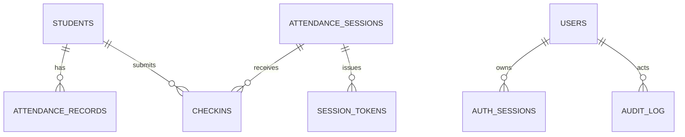

# Database design and review guide

This guide answers the database design questions for Smart College Attendance and points to the implementation. The app supports more than one persistence mode:

| Mode | How it is selected | Database type | Intended use |
| --- | --- | --- | --- |
| SQLite | `DATABASE_URL` unset and Firebase data mode off | Relational, embedded | Local development and one app instance on persistent storage |
| PostgreSQL | `DATABASE_URL` set (requires Firebase faculty sign-in) | Relational, client/server | Hosted production deployment and multiple app processes |
| Firestore | Firebase enabled and `DATABASE_URL` unset | Document database | Optional Firebase-backed attendance storage |

The README describes setup and deployment. The executable schemas are initialized in [`server/database.js`](server/database.js) (SQLite) and [`server/postgres-store.js`](server/postgres-store.js) (PostgreSQL); Firestore document operations are in [`server/firestore-store.js`](server/firestore-store.js).

## Q1. Why these databases?

The main data is structured: a roster, dated attendance facts, check-in events, staff identities, sessions, and audit events. Attendance has clear relationships and needs uniqueness rules such as one attendance result for each student on a date. A relational database fits these entities and their joins well. Geofence settings and audit details are small flexible JSON values, stored as SQLite text JSON, PostgreSQL `JSONB`, or Firestore document fields.

The common workload is read-heavy: load the roster with today's status and attendance summaries, show recent check-ins, and read session/geofence state. Writes are smaller but correctness-sensitive: mark attendance, import a roster, start/end a session, and submit a check-in. The development seed contains 24 students. There is no stated production volume or capacity target in the code; attendance history grows roughly with students × class days, while current roster and recent-check-in reads remain bounded. Production should establish a retention and volume target from the institution's actual class schedule and roster size.

SQLite is appropriate for local use because it is simple to run and reliable for a single process. PostgreSQL is the hosted choice because it supports concurrent clients, foreign keys, transactions, and managed deployment. Firestore is available for an existing Firebase setup; the rest of this guide treats PostgreSQL as the production relational model.

The most important operations are:

1. **Roster plus today's attendance and totals.** PostgreSQL's `listStudents()` in `server/postgres-store.js` left-joins today's row and computes counts from `attendance_records`; SQLite's `listStudents()` is in `server/database.js` and the API computes summaries in `server/index.js`.
2. **Validate and record a QR check-in.** `checkIn()` in `server/postgres-store.js` reads the token/session, geofence and student, then writes an attendance row and a check-in row. The Firestore equivalent is `checkInCloud()` in `server/firestore-store.js`.
3. **Read recent check-ins / attendance history.** `recentCheckins()` and `attendanceReport()` in `server/postgres-store.js` serve the dashboard and reports.

Example of the seeded roster data in development (from `server/database.js`):

```json
{
  "id": 1,
  "name": "Aarav Sharma",
  "roll": "22CS101",
  "department": "CSE",
  "percentage": 96,
  "today": "present",
  "notified": false
}
```

The `today` and percentage fields in this seed are initial demo values. For actual attendance history, `attendance_records` is the source used for calculated summaries.

**Alternative considered:** a document store such as Firestore is also implemented, but was not selected as the default hosted relational store. Relational constraints and joins express attendance-to-student relationships directly and make multi-row updates easier to keep atomic. A key-value store would make the dated history and reporting queries less natural. Firestore remains an option where Firebase integration is preferred, with more data integrity and aggregation rules handled in application code.

## Q2. Schema and relationships

The relational schema is initialized by `CREATE TABLE IF NOT EXISTS` statements in `server/database.js` and `initializePostgres()` in `server/postgres-store.js`. PostgreSQL is the production schema; SQLite has the same main entities plus local password-auth tables. The diagram shows the core relationships (arrows point from child foreign keys to parent keys):



| Table | Key and purpose |
| --- | --- |
| `students` | PK `id`; unique roll number; name, department, and display/cache fields |
| `attendance_records` | Composite PK `(student_id, attendance_date)`; one status per student per date; FK to `students` |
| `checkins` | PK `id`; a QR submission with student, date/time, distance, and location; FK to `students`; PostgreSQL unique `(student_id, attendance_date)`, SQLite unique `(student_id, session_id)` |
| `attendance_sessions` | PK `id`; active/inactive class attendance window |
| `session_tokens` | PK `token`; FK `session_id` to `attendance_sessions`; expiring QR pass |
| `settings` | PK `setting_key`; geofence and other small configuration values |
| `staff` (PostgreSQL) / `users` (SQLite local auth) | Email or integer PK; faculty/admin account data |
| `audit_log` | PK `id`; actor, action, entity, details, and timestamp |
| `auth_sessions` (SQLite only) | PK token hash; FK to local `users` |
| `data_migrations` (PostgreSQL only) | PK migration key; completion marker and imported counts |

There is a one-to-many relationship from a student to dated attendance rows and check-ins, and from a session to issued QR tokens. The many-to-many idea “students attend many class dates, each date has many students” is resolved by `attendance_records`, whose composite key also prevents duplicate student/date attendance. QR submissions are stored separately in `checkins` so their location and submission time can be retained.

Representative query from `listStudents()` in `server/postgres-store.js`:

```sql
SELECT s.id, s.name, s.roll, s.department,
       COALESCE(day.status, s.today) AS today,
       COALESCE(stats.total, 0) AS total_sessions
FROM students s
LEFT JOIN attendance_records day
  ON day.student_id = s.id AND day.attendance_date = $1
LEFT JOIN LATERAL (
  SELECT COUNT(*) AS total
  FROM attendance_records
  WHERE student_id = s.id
) stats ON TRUE
ORDER BY s.name;
```

In Firestore mode, the corresponding collections are `students/{id}`, `attendance/{date}_{studentId}`, `checkins/{date}_{studentId}`, `attendanceSessions/{id}`, `qrTokens/{token}`, `settings/{key}`, and `auditLog/{id}`. Student summary counters are embedded in student documents to avoid scanning all history for every dashboard read; individual attendance facts and check-ins are separate documents so they can grow independently.

## Q3. Normalization and deliberate duplication

The core relational facts are in 3NF (and the key-based tables are generally BCNF):

- In `attendance_records`, `(student_id, attendance_date)` determines `status`, `source`, `recorded_by`, and `recorded_at`. The key is the whole composite key, so there are no partial dependencies. Other non-key values depend on that key, not on another non-key attribute, so there is no transitive dependency.
- In `students`, `id` determines name, roll, and department; roll is also a candidate key because it is unique. Student attributes live with the student rather than being repeated on each attendance fact.

There are two deliberate denormalizations. First, `students.today` and `students.percentage` are convenient display/cache fields, while dated attendance rows are the historical source. The PostgreSQL roster query calculates percentage from history; local SQLite similarly derives it for the API. Attendance mutations update `students.today` alongside the dated record (`recordAttendance()` in `server/postgres-store.js`; corresponding SQLite attendance logic in `server/index.js`). This cache can be reconciled from attendance history if needed.

Second, PostgreSQL `checkins` duplicates student `name` and `roll` as submission-time snapshot fields. The Firestore check-in document also stores these values. This preserves a useful audit display if roster data is later edited. The snapshot is intentionally historical and is not synchronized after a roster rename; current identity should be read through `student_id` -> `students`.

Firestore duplicates `attendedCount`, `sessionCount`, `percentage`, and `today` in student documents. `changeAttendance()` in `server/firestore-store.js` updates the attendance document and these summary fields together in a Firestore transaction, adjusting counts based on any old status. This trades extra write work for fast dashboard reads. Unbounded attendance history is kept in separate documents rather than embedded arrays, avoiding document growth limits.

Before/after for the relational attendance fact:

```text
Before (conceptual): student row contains only today='present' and percentage=96
After:  student row + attendance_records(student_id, date, status='present', source='qr', ...)
        The dated row preserves history; today/percentage remain convenient summaries.
```

## Q4. Data correctness

### Constraints

PostgreSQL enforces primary keys, unique student roll, unique staff email, foreign keys from attendance/check-ins/tokens, `NOT NULL` on required fields, and `CHECK` on attendance status. `attendance_records` has `PRIMARY KEY (student_id, attendance_date)`. PostgreSQL `checkins` has `UNIQUE(student_id, attendance_date)`, preventing a second same-day check-in. SQLite has these protections plus checks for percentage range, student display status, boolean `notified`, local user role/active, and attendance source; its check-in uniqueness is per student and session. SQLite enables `PRAGMA foreign_keys = ON`.

Application code also validates user-facing input and business rules that are contextual: valid status transitions, QR token expiry and active session, geofence radius, and whether a student can check in again. PostgreSQL's `students.today` currently has no `CHECK` constraint (SQLite does); API validation is responsible for the allowed values in PostgreSQL mode.

Example database rule that rejects invalid attendance status:

```sql
-- Present in both relational schema initializers
status TEXT NOT NULL CHECK (status IN ('present','absent','late'))
```

An attempt to insert `status = 'excused'` into `attendance_records` is rejected by the database. No live database is bundled with the repository, so this is shown from the executable constraint definition rather than a run against a configured deployment.

### Transactions and concurrency

In PostgreSQL mode, `withTransaction()` in `server/postgres-store.js` sends `BEGIN`, then commits if the callback succeeds or rolls back and rethrows on error. `setStudentAttendance()` changes the dated attendance row, the student's current `today` value, and the audit row in one transaction. A failure during any of those writes rolls all of them back. `checkIn()` similarly writes attendance and check-in records in one transaction. The migration imports all collections and writes its completion marker in one transaction.

PostgreSQL uses its default `READ COMMITTED` isolation; there is no explicit row lock or serializable isolation. Concurrent identical attendance writes are bounded by the composite primary key and check-in unique constraint. On a simultaneous QR check-in, one transaction wins the unique check-in insert; the other transaction fails and rolls back its attendance change. The API reports the operation failure. For ordinary manual attendance upserts, the unique key serializes the conflicting row update and the last committed update is retained.

SQLite uses `better-sqlite3` transactions for seeded/imported batches and enables WAL with a busy timeout; SQLite serializes writers, suitable for the documented single-instance use. Firestore uses single-document atomic writes and `runTransaction()` for attendance fact plus student summary updates. However, the Firestore QR check-in path currently checks the attendance record before calling its transaction, and writes the check-in document afterward; that whole path is not one multi-document transaction. Firestore therefore does not provide the same all-or-nothing check-in guarantee as PostgreSQL in this implementation. Firestore's consistency model is handled by the SDK; no separate eventual-consistency mechanism is implemented by the app.

## Q5. Efficiency, indexes, and growth

PostgreSQL creates these secondary indexes in `initializePostgres()`:

| Index | Supports |
| --- | --- |
| `attendance_date_idx(attendance_date)` | Date-based attendance reporting and weekly totals |
| `checkins_date_idx(attendance_date, created_at DESC)` | Recent check-ins for a date, newest first |
| `audit_log_created_idx(created_at DESC)` | Recent audit-log reads |

Primary keys and unique constraints create supporting indexes for student ID/roll, attendance student/date, check-in uniqueness, staff email, session tokens, and settings keys. SQLite relies on primary-key and unique indexes; it does not currently create explicit secondary indexes. No extra index on `students.name` or department is defined: the current roster query sorts the roster and user-side filters operate on the loaded roster, while such indexes would add write and storage cost. There is no sharding or partitioning. PostgreSQL is connection-pooled (`PG_POOL_MAX`, default 5); SQLite is limited to one application instance.

At 100× users, the first pressure points are likely full roster loading and repeated attendance aggregation, check-in/report reads, and the small default PostgreSQL connection pool. The next steps would be based on query plans and observed workload: add targeted composite indexes for real filter patterns, page roster and report endpoints, maintain rollup tables/materialized summaries, raise or tune the connection pool within the database's limits, and partition older attendance history by date if retention and volume justify it. SQLite should be replaced by hosted PostgreSQL before running multiple replicas. Sharding is not warranted by the current design or stated scale.

## Source map

- SQLite DDL, sample seed, local settings, indexes-by-constraint: `server/database.js`
- PostgreSQL DDL, indexes, transactions, attendance queries and check-in: `server/postgres-store.js`
- Firestore document layout and transaction/summary logic: `server/firestore-store.js`
- API routing and datastore selection: `server/index.js`
- Deployment settings and migration instructions: `README.md`
