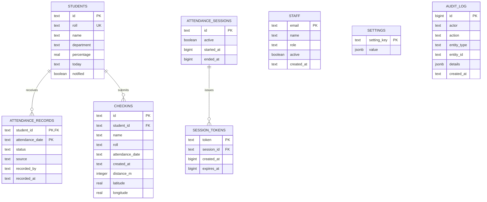

# ER diagram

`attendance_records` is the associative entity for the many-to-many student/date relationship. The date is stored as an ISO date value in a text column to match the current backend schema. The PostgreSQL schema does not have a `dates` table or a direct check-in-to-session foreign key. `audit_log.actor` is intentionally text because actors can be Firebase identities; it is not a foreign key to `staff`.
